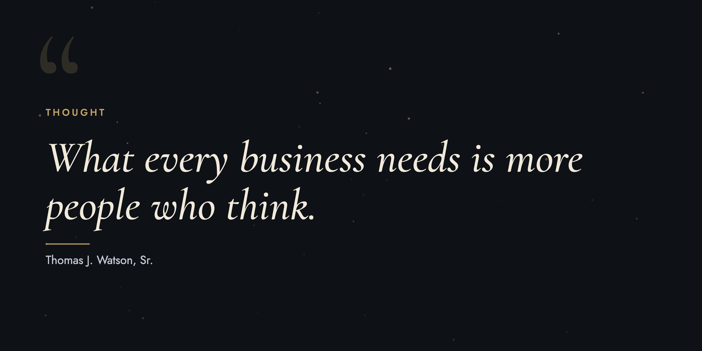

  <h1>✨ Quintessential Quotes</h1>
  
<b>An AI-Powered Curated Wisdom Experience</b>

  
  <!-- Clickable Live App Preview Image -->
  

  
<b>👉 <a href="https://nwadmark.github.io/quintessential-quotes/" target="_blank">Click here to launch the live app in a new tab</a> 🚀</b>

  
  
  

---

## 🎯 Summary

**Quintessential Quotes** is a production-ready, AI-native web application engineered to deliver context-aware, meticulously formatted enterprise wisdom. 

> *"What every business needs is more people who think."* — **Thomas J. Watson, Sr.**

This initiative bridges foundational corporate philosophy with modern digital architecture and artificial intelligence orchestration, serving as an operational showcase of strategic product design, user engagement mechanics, and rigorous technical execution.

---

## 🏛️ The Philosophy of THINK: Historical Context

*Derived from an interactive deck of quotes from IBM leaders (1914–2002), compiled from the IBM Archives **"Quintessential Quotes"** repository ([Reference Source](https://www.infania.net/misc/ibmhistory/pdf/quotes.pdf)).*

Long before contemporary enterprise culture prioritized cognitive frameworks and organizational mindset, Thomas J. Watson Sr. established an enduring paradigm with a singular mandate: **THINK**. 

* **The Foundational Moment (December 1911):** Addressing a convention where tactical execution overshadowed strategic ideation, Watson realigned the organization's trajectory, emphasizing: 
  > *"The trouble with every one of us is that we don't think enough. We don't get paid for working with our feet – we get paid for working with our heads."*
* **The Codification of an Ethos:** By immortalizing **THINK** as a guiding principle, Watson instituted a standard that rejected complacency in favor of deliberate intellectual rigor.
* **The Enterprise Legacy:** Upon transitioning to CTR (subsequently **IBM**) in 1914, the philosophy evolved into a global cornerstone of corporate governance and operational excellence, exemplified by institutional artifacts such as *THINK Magazine*.

---

## 🤖 AI Orchestration & Product Execution

This repository highlights the tactical execution behind modern software delivery:
* **AI-Assisted Prototyping:** Structured and developed utilizing advanced large language model (LLM) workflows combined with clean, responsive front-end design standards.
* **User Experience & Interaction Design:** Calibrated typography, spatial design, and visual hierarchy to optimize engagement metrics and session retention.
* **Deployment & CI/CD Operations:** Streamlined continuous deployment globally via GitHub Pages to guarantee high availability and frictionless access.

---

  <i>"Knowledge is the result of thought, and thought is the keynote of success." — Thomas J. Watson Sr.</i>

